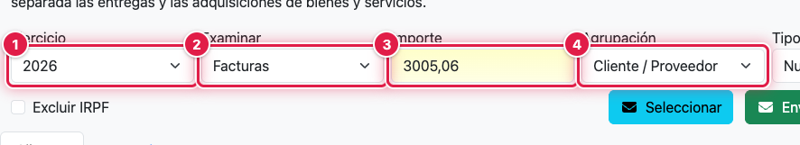
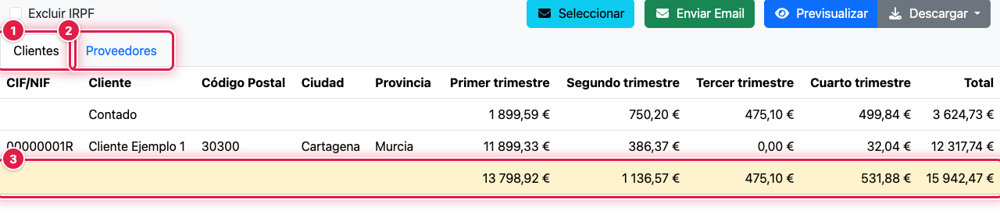
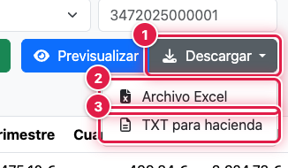
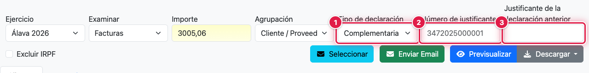

El modelo 347 es la declaración anual informativa de operaciones con terceras personas que se presenta ante la AEAT. El plugin Modelo347 calcula, a partir de tus facturas o de tu contabilidad, qué clientes y proveedores han superado el importe mínimo durante el ejercicio, con su desglose por trimestres, y te deja descargar el resultado en Excel o en el fichero TXT para presentarlo.

## ✅ Quién tiene que declararse

Hay que declarar a cada cliente y proveedor con el que hayas operado por **más de 3.005,06 €** durante el año natural. El programa propone ese importe por defecto y lo puedes cambiar si necesitas hacer otra consulta. La declaración se presenta durante el mes de febrero del año siguiente: el modelo 347 de 2025 se presenta en febrero de 2026.

## ⚙️ Antes de empezar

- Activa el plugin desde **menú Administrador** → **Plugins**.
- Comprueba que tus clientes y proveedores tienen **CIF/NIF**, **provincia** y **país**: son datos obligatorios en la declaración y el programa avisa de los que faltan.
- Rellena el **administrador** y el **teléfono** de la empresa, que también se piden en el fichero.

## 📋 Calcular el modelo

1. Entra en **menú Informes** → **Fiscalidad España** → **Modelo 347**.
2. Elige el **Ejercicio** (1) que quieres declarar.
3. En **Examinar** (2) elige de dónde salen los importes: **Facturas** (lo habitual) o **Contabilidad**.
4. En **Importe** (3) deja 3005,06 o escribe otro mínimo.
5. En **Agrupación** (4) elige **Cliente / Proveedor**, que suma por cada ficha, o **CIF/NIF**, que junta en una sola fila todas las fichas con el mismo identificador fiscal (útil si un mismo CIF/NIF aparece con varios nombres).

Si marcas **Excluir IRPF**, se dejan fuera las facturas con retención de IRPF. Esta opción y la exclusión de facturas concretas (ver [Excluir clientes o facturas del modelo 347](excluir-clientes-o-facturas-del-modelo-347.md)) se aplican tanto si calculas desde **Facturas** como desde **Contabilidad**: en este último caso se quitan los asientos de esas facturas.

## 👁️ Revisar el resultado

Pulsa **Previsualizar**. Debajo del formulario aparece la pestaña **Clientes** (1) con las ventas y la pestaña **Proveedores** (2) con las compras. Cada fila muestra el CIF/NIF, el nombre, la población, los importes de los cuatro trimestres y el total anual; la última fila, resaltada (3), suma todos los terceros.

⚠️ Si falta algún dato obligatorio, arriba de la pantalla aparecen avisos con el nombre del cliente o proveedor y lo que le falta. Corrige la ficha y vuelve a pulsar **Previsualizar**.

## ⬇️ Descargar el archivo

1. Pulsa **Descargar** (1).
2. Elige **Archivo Excel** (2) para guardar una hoja de cálculo con una pestaña de clientes y otra de proveedores, útil para revisarla o entregársela a tu asesor.
3. Elige **TXT para hacienda** (3) para obtener el fichero `modelo_347_<ejercicio>.347`, que se sube en la sede electrónica de la AEAT.

## 📝 Declaración complementaria o sustitutiva

Antes de descargar el TXT puedes indicar el **Tipo de declaración**: **Nueva** (la primera presentación), **Complementaria** o **Sustitutiva**. También puedes escribir el **Número de justificante** de 13 dígitos que asigna la AEAT. Al elegir complementaria o sustitutiva aparece **Justificante de la declaración anterior**, donde escribes el justificante de la presentación que corriges.

⚠️ Los justificantes deben tener 13 dígitos y empezar por 347. Si el justificante no tiene ese formato, o falta el de la declaración anterior en una complementaria o sustitutiva, el programa avisa y no descarga el TXT. Si dejas vacío el **Número de justificante**, el programa genera uno con el año del ejercicio.

## ❓ Preguntas frecuentes

**¿Se incluyen clientes y proveedores extranjeros?** Sí, siempre que tengan país y operaciones por encima del importe.

**¿Salen las facturas con retención de IRPF?** Sí, salvo que marques **Excluir IRPF**.

**¿Y las operaciones de series sin IVA?** No se cuentan, ni desde **Facturas** ni desde **Contabilidad**.

## Ver también

- [Informe de clientes y proveedores por importe](informe-de-clientes-y-proveedores-por-importe.md)
- [Enviar la carta del modelo 347 por email](enviar-la-carta-del-modelo-347-por-email.md)
- [Excluir clientes o facturas del modelo 347](excluir-clientes-o-facturas-del-modelo-347.md)
