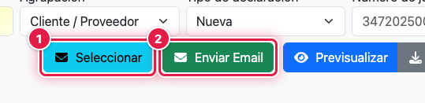
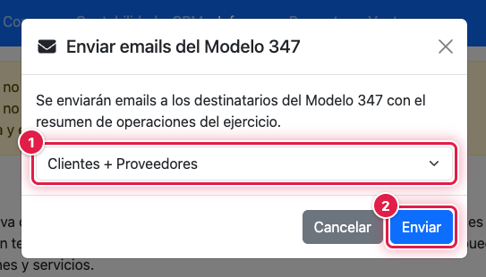

Antes de presentar el modelo 347 es habitual avisar a cada cliente y proveedor del importe que vas a declarar de él. El plugin lo hace por ti: envía a cada tercero un email con su importe por trimestres y su total, y puedes enviarlo a todos de golpe o elegir uno a uno a quién.

## ⚙️ Antes de empezar

- El **email del programa** debe estar configurado (desde **menú Administrador** → **Email**). Si no lo está, el envío se rechaza con un aviso.
- Necesitas permiso para modificar en la pantalla del modelo 347. Sin él, los botones de envío no aparecen.
- El texto del email sale de dos notificaciones que el plugin crea al activarse: `modelo347-customers` para los clientes y `modelo347-suppliers` para los proveedores. Deben existir y estar activadas; si no, no se envía nada.
- El email se toma de la ficha del cliente o proveedor y, si no tiene, de su dirección predeterminada o de cualquier otra dirección suya. Quien no tenga ninguno se salta y el programa te avisa de ello.

## ✉️ Enviar a todos

1. Entra en **menú Informes** → **Modelos fiscales** → **Modelo 347** y ajusta el ejercicio, el importe y la agrupación como para el cálculo.
2. Pulsa **Enviar Email** (2).
3. En la ventana, elige a quién enviar (1): **Clientes + Proveedores**, **Clientes** o **Proveedores**.
4. Pulsa **Enviar** (2).

El programa responde con cuántos emails ha encolado. Los emails no salen todos a la vez: se envían en segundo plano, con unos segundos de diferencia entre uno y otro, durante los minutos siguientes. Dos terceros que compartan la misma dirección reciben cada uno su email, porque sus importes son distintos. Si el servidor de correo falla con alguno, el programa lo vuelve a intentar cinco minutos después, hasta tres veces, y deja un aviso en el registro.

⚠️ Mientras haya emails pendientes del mismo ejercicio y tipo, no se puede volver a enviarlos: espera a que terminen.

## 👥 Elegir a quién enviar

Si solo quieres avisar a algunos terceros:

1. Con la pestaña **Clientes** o **Proveedores** activa, pulsa **Seleccionar** (1).
2. En la pantalla **Destinatarios del modelo 347**, la columna **Incluidos** lista los terceros con email. Usa el buscador para filtrar: separa varios términos con espacios y usa `%` para indicar «empieza por» (`texto%`) o «termina por» (`%texto`).
3. Pasa los que quieras a la columna **Seleccionados** con las flechas; las flechas dobles pasan o quitan todos los visibles.
4. Abre **Vista previa de la carta** para ver el asunto y el texto que recibirán.
5. Pulsa **Enviar**, que muestra el número de seleccionados.

Con **Volver** regresas a la pantalla del modelo sin enviar nada.

## ✏️ Personalizar el texto

Desde **menú Administrador** → **Email**, pestaña **Notificaciones**, abre `modelo347-customers` o `modelo347-suppliers` y edita el asunto y el cuerpo. Puedes usar estas etiquetas, que se sustituyen por los datos de cada tercero:

| Etiqueta | Valor |
|---|---|
| `{name}` | Nombre o razón social |
| `{cifnif}` | CIF/NIF |
| `{email}` | Email de destino |
| `{year}` | Año del ejercicio |
| `{amount}` | Importe mínimo |
| `{t1}` a `{t4}` | Importe de cada trimestre |
| `{total}` | Total anual |
| `{deadline}` | Fecha límite de disconformidad |

## Ver también

- [Cómo generar y presentar el modelo 347](como-hacer-el-modelo-347.md)
- [Excluir clientes o facturas del modelo 347](excluir-clientes-o-facturas-del-modelo-347.md)
