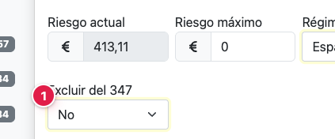
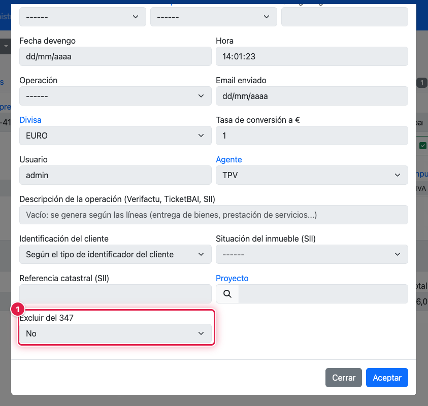

Hay clientes o proveedores cuyas operaciones no deben salir en el modelo 347, por ejemplo porque ya se declaran por otra vía. El plugin añade el campo **Excluir del 347** a las fichas de clientes y proveedores y a las facturas, para dejar fuera del cálculo lo que no corresponde.

## 👤 Excluir a un cliente o proveedor

1. Abre la ficha del cliente (**menú Ventas** → **Clientes**) o del proveedor (**menú Compras** → **Proveedores**).
2. En la pestaña principal, busca el campo **Excluir del 347** (1), junto a los términos comerciales, y elige **Sí**.
3. Pulsa **Guardar**.

A partir de ese momento, todas las facturas nuevas de ese cliente o proveedor se crean ya excluidas. Las facturas que ya existían conservan su valor: cámbialo en cada una si hace falta.

## 🧾 Excluir una factura concreta

1. Abre la factura y pulsa **Detalle**.
2. En la ventana, cambia **Excluir del 347** (1) a **Sí**.
3. Pulsa **Aceptar** y guarda la factura.

⚠️ En una factura no editable, el campo aparece bloqueado. Si la factura se genera desde un albarán o un pedido, hereda el valor del documento de origen y, si el origen no lo tiene, el del cliente o proveedor.

## 🔎 Qué cambia en el modelo

Las facturas marcadas con **Sí** no se suman en **Menú Informes** → **Fiscalidad España** → **Modelo 347**, ni en la previsualización ni en el Excel o el TXT. La exclusión se aplica con los dos orígenes de **Examinar**: con **Facturas** no se suma la factura y con **Contabilidad** no se suma su asiento.

## Ver también

- [Cómo generar y presentar el modelo 347](como-hacer-el-modelo-347.md)
- [Informe de clientes y proveedores por importe](informe-de-clientes-y-proveedores-por-importe.md)
