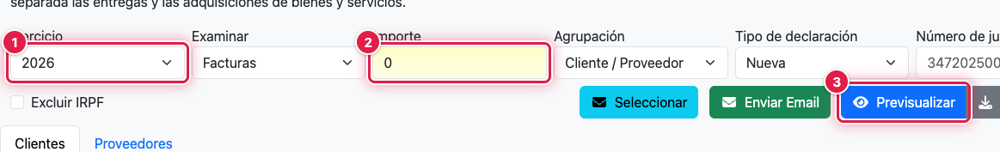
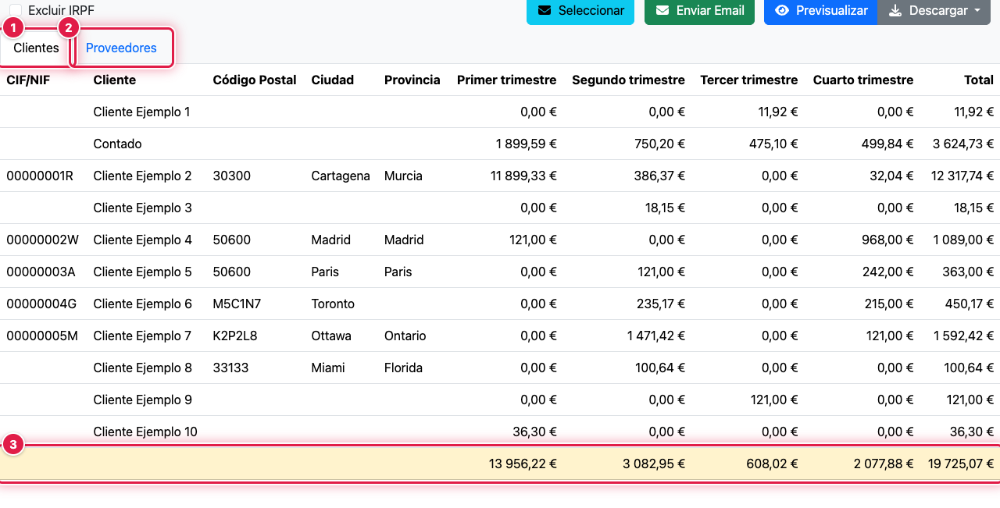
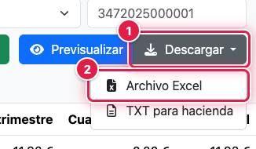

La pantalla del modelo 347 no solo sirve para la declaración: también te da el listado de todos los clientes o proveedores que han superado un importe en un ejercicio, con su desglose por trimestres, y lo puedes llevar a Excel. Solo tienes que cambiar el importe mínimo.

## 📋 Obtener el listado

1. Entra en **menú Informes** → **Modelos fiscales** → **Modelo 347**.
2. Elige el **Ejercicio** (1) del que quieres el informe.
3. Cambia el **Importe** (2) por el mínimo que te interesa: por ejemplo 1000 para ver quién ha operado por más de 1.000 €, o 0 para ver a todos sin filtro.
4. Pulsa **Previsualizar** (3).

El resultado aparece debajo: la pestaña **Clientes** (1) muestra las ventas y la pestaña **Proveedores** (2), las compras. Cada una trae los cuatro trimestres y el total anual, y la fila resaltada (3) suma todos los terceros.

⚠️ Con el importe a 0 el programa también avisa de los datos que faltarían para presentar la declaración (provincia, país...). Para el informe puedes ignorarlos.

## ⬇️ Llevarlo a Excel

Pulsa **Descargar** (1) y elige **Archivo Excel** (2). Obtendrás una hoja de cálculo con una pestaña para los clientes y otra para los proveedores, ambas con la fila de totales.

## 🔎 Opciones que cambian el resultado

- **Examinar**: calcula el importe desde las **Facturas** o desde la **Contabilidad**.
- **Agrupación**: **Cliente / Proveedor** muestra una fila por ficha; **CIF/NIF** suma en una sola fila las fichas que comparten identificador fiscal.
- **Excluir IRPF**: deja fuera las facturas con retención.

## Ver también

- [Cómo generar y presentar el modelo 347](como-hacer-el-modelo-347.md)
- [Excluir clientes o facturas del modelo 347](excluir-clientes-o-facturas-del-modelo-347.md)
